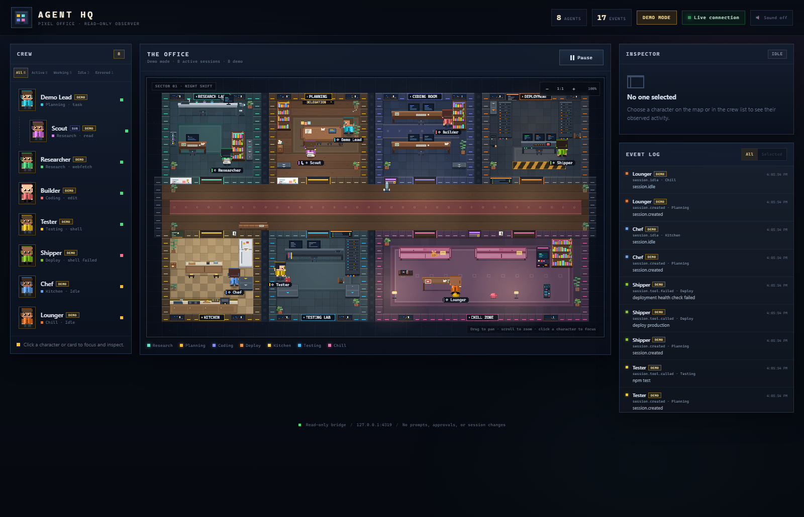

# Agent HQ - Pixel Office

> This is the detailed engineering reference and verification log. See
> [README.md](README.md) for the project overview and quick start.

A local, read-only window into coding-agent sessions. Every session, including
subagents, becomes a character in a small pixel-art office, walks to a room
that matches its observed tool activity, and streams updates into a live event
log. OpenCode is the live-tested provider; documented command-hook adapters for
Claude Code and Codex are included as well.



*Eight-agent seeded demo in explicit demo mode, captured during a confirmed
parent/child planning huddle. Demo badges and the header label keep it distinct
from live provider traffic. Live history is restored from SQLite after a bridge
restart; disconnected sessions are shown as Offline, not as current work.*

The dashboard only observes. It never sends prompts, approves permissions,
stops sessions, or changes model/provider configuration.

## Highlights

- **Walkable office map** - 60 x 34 tiles, seven connected rooms, collision,
  BFS pathfinding, doors, corridors, furniture, plants, lamps, and wall decor.
- **Room-specific set dressing** - whiteboards, specimen jars, a telescope, a
  credenza, tall plants, UPS and cable reels, a tool cart, vending machine,
  record player, menu board, clocks, and animated monitors/steam/LEDs.
- **Characters, not emoji** - original procedural pixel sprites generated from
  each session's stable color. Characters walk, turn, sit, relax, read, type,
  use tools, and celebrate confirmed successes.
- **Factual state, not invented progress** - status text comes from observed
  events. There are no made-up percentages or completion claims.
- **Provider-scoped identity** - a session is identified by `(provider, id)`,
  so OpenCode, Claude Code, and Codex can reuse the same session ID without
  overwriting each other's state, colors, activity, or parent links.
- **Session history** - SQLite keeps identities, provider, session metadata,
  confirmed parent/child links, recent activity, and event dedupe keys. The
  original OpenCode-only database is migrated in place.
- **Honest recovery** - after a bridge restart, unfinished sessions become
  Offline with their last observed status retained. Terminated sessions stay
  `Session closed`.
- **Reconnect handling** - the browser fetches a fresh snapshot, opens a new
  WebSocket, and receives an initial snapshot. While the bridge is unreachable,
  the last-known picture is marked STALE and idle.
- **Live/demo isolation** - separate default databases, explicit provenance,
  and server-side rejection of cross-mode traffic.
- **Read-only observer** - no prompt injection, tool approval, stop control, or
  model/provider mutation.

## Requirements

- Windows 10 or 11 (PowerShell examples below)
- Node.js 22.13 or newer with the built-in `node:sqlite` module
  - Verified with Node v22.23.2 and npm 10.9.8
- OpenCode V2 with the local observer plugin (the live-tested integration)
- Claude Code with command hooks (optional; see the exact setup below). The
  example uses exec-form `args`; use the equivalent shell-form command if your
  Claude Code version is older than the exec-form support.
- Codex 0.162 or newer with its stable command hooks (optional; see the exact
  setup below). Verified with `codex-cli 0.162.0-alpha.17.2`. A signed-in Codex
  account is required for model turns and tool activity.
- A modern browser

Check the runtime:

```powershell
node --version
npm --version
```

`node:sqlite` is still marked experimental by Node, so a Node
`ExperimentalWarning` at startup is expected.

## Install and start

From PowerShell:

```powershell
cd D:\opencode\agents-gui
npm install
npm start
```

Open:

```text
http://127.0.0.1:4318/
```

`npm start` runs the TypeScript server through `tsx`. Keep that terminal open.
For development with automatic restart on source changes:

```powershell
npm run dev
```

### Start detached in the background

This starts the bridge with logs in `data\bridge.log` and returns to the prompt:

```powershell
New-Item -ItemType Directory -Force data | Out-Null
Start-Process cmd.exe -ArgumentList '/c', 'npm start > data\bridge.log 2>&1' -WorkingDirectory 'D:\opencode\agents-gui' -WindowStyle Hidden
```

Check it:

```powershell
Invoke-RestMethod http://127.0.0.1:4318/health | ConvertTo-Json -Depth 4
Get-Content D:\opencode\agents-gui\data\bridge.log -Tail 20
```

### Start demo mode

Demo mode uses a separate database and rejects live traffic. Use a different
port so a live bridge can keep running:

```powershell
$env:AGENT_OFFICE_DEMO = "1"
$env:AGENT_OFFICE_PORT = "4319"
cd D:\opencode\agents-gui
npm start
```

Open `http://127.0.0.1:4319/`. To return to live mode, start a new shell without
those environment variables, or clear them:

```powershell
Remove-Item Env:AGENT_OFFICE_DEMO -ErrorAction SilentlyContinue
Remove-Item Env:AGENT_OFFICE_PORT -ErrorAction SilentlyContinue
```

## OpenCode observer plugin

The read-only observer lives outside this repository:

```text
%USERPROFILE%\.config\opencode\plugins\agent-office.ts
```

It sends curated session metadata and safe tool descriptions to:

```text
http://127.0.0.1:4318/events
```

The plugin does **not** forward prompts, message text, reasoning, diffs, file
contents, or complete event payloads. It sends:

- provider identifier (`opencode`)
- session ID and session title/agent name
- confirmed `parentID` when OpenCode exposes it
- event type and event ID for dedupe
- tool name
- an allow-listed detail such as a file path, glob, command, URL, or search
  query
- status/error messages, with common credential patterns redacted

Commands and paths can still be sensitive. Treat the local dashboard as
local-sensitive data, not as a public feed.

Restart OpenCode after changing the plugin so the updated observer is loaded.
If the bridge is closed, the plugin drops events rather than interrupting work.

### Custom bridge URL or port

The server defaults to `127.0.0.1:4318`. To use another port, start the server
with `AGENT_OFFICE_PORT` and make the plugin use the matching URL. For example:

```powershell
$env:AGENT_OFFICE_PORT = "4320"
$env:AGENT_OFFICE_URL = "http://127.0.0.1:4320/events"
cd D:\opencode\agents-gui
npm start
```

Set `AGENT_OFFICE_URL` in the environment OpenCode inherits, then restart
OpenCode. The bridge itself still binds only to `127.0.0.1`.

## Provider support

| Provider | Status | What was verified |
| :- | :- | :- |
| OpenCode | Implemented and live-tested | Real sessions, subagents, parent links, failures, restart/restore |
| Claude Code | Implemented via documented command hooks | Adapter, real hook script, HTTP ingestion, provider isolation, persistence, and redaction tested with documented hook payloads |
| Codex | Implemented via stable command hooks | Installed `codex-cli 0.162.0-alpha.17.2` parsed the exact registration; a real `codex exec` lifecycle reached a real bridge; documented tool, subagent, compaction, interrupt, and boundary payloads are tested. No authenticated model turn was available here. |

The bridge does not pretend every provider is equivalent. OpenCode uses its
existing local observer plugin. Claude Code and Codex use their official
command-hook interfaces, with separate adapters and separate payload schemas.
Codex hooks are a stable feature in the installed version, but they do not
expose every Claude Code event; see the mapping and limitations below.

### How provider identity works

`provider` is an additive field on every agent and activity item. The internal
identity is `(source, provider, id)`, so these are different sessions:

```text
(live, opencode,    ses_shared)
(live, claude-code, ses_shared)
```

Session IDs stay exactly as the provider reports them. Two providers cannot
overwrite each other's status, room, parent link, color, activity, or dedupe
keys. Existing OpenCode clients that omit `provider` still work: missing
provider values default to `opencode`.

## Claude Code observer hook

This is an **observational** command hook. It reads the hook JSON from stdin,
forwards only allowlisted metadata to the local bridge, writes nothing to
stdout, and exits 0. It cannot prompt, approve, block, stop, or change a model.

### Files

```text
integrations\claude-code\agent-office-hook.mjs
integrations\claude-code\settings.example.json
```

The example settings use this checkout's absolute path. If the repository is
somewhere else, change the `args` path before installing it. If `node` is not on
the PATH inherited by Claude Code, use the full path to `node.exe`. The hook
defaults to `http://127.0.0.1:4318`; if you change the bridge port, set
`AGENT_OFFICE_URL` in the environment Claude Code inherits. The hook accepts a
base URL, a URL ending in `/events`, or the full
`http://127.0.0.1:4318/events/claude-code` URL. The OpenCode plugin still expects
the full `/events` URL.

The example uses Claude Code's exec form (`command: "node"` plus `args`). On
Windows this is the safest form because `node.exe` is a real executable and the
script path is passed as one argument. If your Claude Code version does not
support `args`, use shell form instead:

```json
{
  "type": "command",
  "command": "node \"D:\\opencode\\agents-gui\\integrations\\claude-code\\agent-office-hook.mjs\"",
  "timeout": 5
}
```

Keep the hook's environment the same as the terminal that starts Claude Code.
The hook itself needs Node.js 18 or newer; the bridge needs Node.js 22.13 or
newer for `node:sqlite`.

### Install

1. Start the Agent HQ bridge on the default port.
2. Open `%USERPROFILE%\.claude\settings.json` (user-wide) or
   `.claude\settings.json` in the project, and **merge** the `hooks` object from
   `integrations\claude-code\settings.example.json`. Do not replace unrelated
   settings.
3. In Claude Code, run `/hooks`, review the new hooks, and trust them. Non-managed
   hooks must be reviewed before they run.
4. Restart Claude Code. Future sessions appear in Agent HQ as provider
   `claude-code`.

The configured events are:

| Claude Code hook | Canonical event | Dashboard meaning |
| :- | :- | :- |
| `SessionStart` | `session.created` | Session joined |
| `SubagentStart` | `session.created` | Child session with a confirmed parent link |
| `PreToolUse` | `session.tool.started` | Using the reported tool |
| `PostToolUse` | `session.tool.success` | Tool finished |
| `PostToolUseFailure` | `session.tool.failed` | Observed tool failure |
| `Stop` | `session.turn.completed` | Assistant finished its turn (not a task-success claim) |
| `SubagentStop` | `session.turn.completed` | Subagent finished its turn |
| `StopFailure` | `session.error` | API/turn failure |
| `SessionEnd` | `session.terminated` | Session closed |

The event names and input fields above were checked against the official Claude
Code hooks reference on 2026-10-25. Parent links come only from the documented
`agent_id`; an identical `agent_type` or display name is never treated as
parent evidence. `Stop` and `SubagentStop` mark a turn as completed, not a task
as successful.

### What is forwarded

The hook script forwards only:

- session ID, prompt ID, agent ID/type, and custom session title
- hook event name, start source, interrupt flag, and tool name/use ID
- an allow-listed tool detail: command, file path, glob/pattern, URL, search
  query, or subagent type
- the first line of an error, after secret redaction (multi-line command output
  and file content are not forwarded)
- session-end reason and tool duration

It deliberately drops `prompt`, `last_assistant_message`, `transcript_path`,
`agent_transcript_path`, `cwd`, `tool_response`, raw tool input bodies, and the
`Agent`/`Task` description or prompt. Tool commands, paths, and patterns are
truncated to 160 characters and scrubbed before the local POST. The server
applies the same credential redaction to every provider before display or
SQLite persistence. Commands and paths can still be sensitive; keep the port and
`data` directory local.

### Verify the hook path without Claude Code

The repository test suite runs the actual hook script as a child process and
sends documented hook payloads. For a manual smoke test, with the live bridge
running:

```powershell
$payload = '{"hook_event_name":"SessionStart","session_id":"ses_manual_claude","source":"startup","session_title":"Manual Claude Hook Test"}'
$payload | node D:\opencode\agents-gui\integrations\claude-code\agent-office-hook.mjs
Invoke-RestMethod http://127.0.0.1:4318/api/state | ConvertTo-Json -Depth 6
```

This creates a real `claude-code` character. It proves the hook script, HTTP
endpoint, adapter, and persistence path; it is not a substitute for a live
Claude Code account.

**Tested versus planned:** the Claude Code adapter, the exact
`settings.example.json` registration, and the real hook process are tested
against the documented payload shapes. The Claude Code CLI is not installed in
this environment (`claude` is not on `PATH`, and `%USERPROFILE%\.claude` does not
exist), so an actual interactive Claude Code turn has not been run here. The
hook boundary is tested; live Claude Code session observation is not claimed.

## Codex observer hook

Codex `0.162.0-alpha.17.2` reports `hooks` as a stable feature. This integration
uses the official Codex command-hook interface, not the app-server control API
and not a Claude-compatible compatibility layer. Hooks are stable in the
installed version and keep Agent HQ passive; the documented app-server command
and WebSocket transports are experimental and not supported for production
workloads. The observer is strictly observational:
the hook reads JSON from stdin, forwards only allow-listed metadata, writes
nothing to stdout, and exits 0. It cannot send a prompt, approve a tool, stop an
agent, block an action, or change model/provider configuration. All non-session-
end handlers use `async: true`, so Codex does not wait for the observer.

### Files

```text
integrations\codex\agent-office-hook.mjs
integrations\codex\hooks.example.json
```

The example uses this checkout's absolute path. If the repository is somewhere
else, change both the `command` and `commandWindows` values. Codex command hooks
use a shell command string and do not take Claude's exec-form `args` array. If
`node` is not on the PATH inherited by Codex, replace `node` with the full path
to `node.exe`.

The hook defaults to `http://127.0.0.1:4318`. If you change the bridge port, set
`AGENT_OFFICE_URL` in the environment Codex inherits. The hook accepts a base
URL, a URL ending in `/events`, a trailing slash, or the full
`http://127.0.0.1:4318/events/codex` URL. The OpenCode plugin still expects the
full `/events` URL.

### Install on Windows

1. Start the Agent HQ bridge on the default port.
2. Open `%USERPROFILE%\.codex\hooks.json` (or `%CODEX_HOME%\hooks.json` if you
   set `CODEX_HOME`). Create the file if needed, then **merge** the `hooks`
   object from `integrations\codex\hooks.example.json`. If you already have
   Codex hooks, merge each event array instead of replacing the file.
3. In Codex, run `/hooks`, review the new handlers, and trust them. Non-managed
   Codex hooks do not run until reviewed. Review again after changing the
   command or moving the checkout.
4. Restart Codex. Future sessions appear as provider `codex`.
5. Confirm `codex login status` is signed in before expecting model turns, tool
   activity, subagents, or compaction events. Session lifecycle hooks can fire
   before authentication, but a rejected model request will not produce a turn.

After updating the Agent HQ source, restart the bridge once; provider adapters
are loaded at process startup.

The exact registration was parsed by the installed Codex app-server with
`hooks/list`: all ten handlers below were discovered from `hooks.example.json`,
with the expected matcher, timeout, and async flags. That verification used a
temporary `CODEX_HOME`; the real Codex configuration was not modified.

### Event mapping

| Codex hook | Canonical event | Dashboard meaning |
| :- | :- | :- |
| `SessionStart` | `session.created` | Session joined. The matcher excludes the `compact` source; compaction is shown below. |
| `SubagentStart` | `session.created` | Child session with a confirmed parent link |
| `PreToolUse` | `session.tool.started` | Using the reported tool |
| `PostToolUse` | `session.tool.success` | Tool finished. Codex also fires this for non-zero command exits; this is not a success claim. |
| `PreCompact` | `session.compaction.started` | Compaction started |
| `PostCompact` | `session.compaction.ended` | Compaction finished |
| `Stop` | `session.turn.completed` | Turn finished (not a task-success claim) |
| `SubagentStop` | `session.turn.completed` | Subagent turn finished |
| `Interrupt` | `session.interrupted` | Turn was interrupted |
| `SessionEnd` | `session.terminated` | Session closed |

Codex reports tool hooks from a subagent with the parent `session_id` and an
explicit `agent_id`. The adapter uses that reported pair to create the child and
its confirmed `parentID`. It never infers a parent from an agent name or type.
If `agent_id` is absent, no parent relationship is invented. Codex 0.162 does
not provide a dedicated tool-failure or turn-error hook; the bridge does not
fabricate one. `PostToolUse` means the tool call completed, and `Stop` means the
turn ended.

### What is forwarded

The hook forwards only:

- hook event name, session ID, turn ID, agent ID/type, and tool name/use ID
- session start source, session-end reason, and compaction trigger
- for the `Bash` tool only, the redacted shell command used for activity display

It deliberately drops `prompt`, `last_assistant_message`, `transcript_path`,
`agent_transcript_path`, `cwd`, `model`, `permission_mode`, `tool_response`,
raw file contents, patch bodies, and MCP/tool input bodies. `apply_patch` content
in particular is never forwarded; the dashboard shows the tool, not the diff.
Commands are truncated to 160 characters and scrubbed before the local POST. The
server repeats credential redaction before display and SQLite persistence.
Commands and paths can still be sensitive; keep the port and `data` directory
local.

### Verify the hook path without an authenticated Codex turn

The repository test suite runs the real Codex hook script and the exact
`hooks.example.json` shell command. For a manual smoke test, with a temporary or
local bridge running:

```powershell
$payload = '{"hook_event_name":"SessionStart","session_id":"codex_manual","source":"startup"}'
$payload | node D:\opencode\agents-gui\integrations\codex\agent-office-hook.mjs
Invoke-RestMethod http://127.0.0.1:4318/api/state | ConvertTo-Json -Depth 6
```

This proves the hook script, `/events/codex` endpoint, adapter, and persistence
path. It is not an authenticated Codex model turn.

**Real Codex check performed on 2026-10-25:** with a temporary `CODEX_HOME` and
`--dangerously-bypass-hook-trust`, a real `codex exec` process emitted
`SessionStart` and `SessionEnd` through the included hook into a temporary Agent
HQ bridge. `/api/state` showed the real Codex session ID as provider `codex`,
status `Session closed`, with both lifecycle activities. The process then failed
with HTTP 401 because `codex login status` reports **Not logged in**; therefore
no model turn, tool call, subagent, or authenticated session completion occurred
in this environment. The exact `codex-cli 0.162.0-alpha.17.2` interface was
verified; live authenticated Codex tool activity is not claimed. IDE/app-server-
hosted threads were not verified end-to-end here.

Official references:

- Claude Code hooks: <https://code.claude.com/docs/en/hooks>
- Codex hooks: <https://developers.openai.com/codex/hooks>
- Codex app-server protocol (used here only to inspect hook registration):
  <https://developers.openai.com/codex/app-server>

## Persistence and recovery

Default databases:

```text
data\agent-office-live.sqlite
data\agent-office-demo.sqlite
```

SQLite also creates `-wal` and `-shm` sidecar files. They are runtime files and
are ignored by version control.

Override the path with `AGENT_OFFICE_DB`:

```powershell
$env:AGENT_OFFICE_DB = "D:\agent-hq\office.sqlite"
npm start
```

If the same database file is used for both modes, every query and write is still
filtered by a `source` column (`live` or `demo`). Tests cover this case, but
separate files are the default and are easier to inspect.

### Schema migration

The original database stored sessions with `PRIMARY KEY (source, id)`. The
provider-aware schema uses `PRIMARY KEY (source, provider, id)`, plus a
`provider` column on activity and dedupe rows. Opening an old database performs
a lossless in-place migration:

- existing sessions become `provider = 'opencode'`
- IDs, names, colors, parent links, timestamps, statuses, and outcomes are kept
- existing activity rows become `provider = 'opencode'`
- existing dedupe keys become provider-scoped OpenCode keys
- `PRAGMA user_version` changes from `1` to `2`

SQLite's transaction wraps the table rebuild, so a failed migration rolls back
and the bridge falls back to memory rather than serving a half-migrated file.
Back up the live database and its `-wal`/`-shm` sidecars before a major upgrade
if you want an extra rollback point.

### What survives a restart

- Provider, session IDs, names, colors, agent names, and confirmed parent IDs
- Last room/status/event metadata
- The last 100 public activity items (and up to 500 rows in SQLite)
- Event dedupe keys, so replayed durable events do not append duplicates
- Terminated sessions as `Session closed`

On startup, any session that was not terminated is restored as:

- `status`: `Offline`
- `phase`: `offline`
- `connected`: `false`
- `historical`: `true`
- `lastStatus`: the status observed immediately before the bridge stopped

A new event for that session revives only that session and reuses its original
color. Other sessions remain historical. This prevents a restart from making
every old agent look busy.

While the browser cannot reach the bridge, it keeps the last-known picture but
marks it STALE, changes the map characters to idle, and shows `Reconnecting...`.
When the bridge returns, the browser fetches a fresh snapshot before opening the
new WebSocket; the server also sends an initial WebSocket snapshot.

### Retention

- Public activity feed: 100 items
- Persisted activity: approximately 500 rows
- Restored sessions: approximately 100
- History age limit: 30 days for disconnected sessions/activity
- Event dedupe keys: 10,000 rows or 1 hour, whichever is smaller
- Cleanup: after every 100 writes, with parent sessions protected while children
  still reference them

### Database failure behavior

The bridge is designed to keep serving the live map if SQLite cannot open or a
write fails:

- Startup falls back to `memory only`
- `/health` reports `persistence: "memory"` and `databaseOk: false`
- The dashboard continues to work, but history will not survive a restart
- The server log explains the failure

If the database is corrupt, stop the bridge and move the database plus its
sidecars out of the way. Do not delete them if you may want to recover them:

```powershell
$conn = Get-NetTCPConnection -LocalPort 4318 -State Listen -ErrorAction SilentlyContinue | Select-Object -First 1
if ($conn) { Stop-Process -Id $conn.OwningProcess -Force }

$stamp = Get-Date -Format yyyyMMdd-HHmmss
$db = "D:\opencode\agents-gui\data\agent-office-live.sqlite"
Move-Item $db "D:\opencode\agents-gui\data\agent-office-live.$stamp.broken.sqlite"
Move-Item "${db}-wal" "D:\opencode\agents-gui\data\agent-office-live.$stamp.broken.sqlite-wal" -ErrorAction SilentlyContinue
Move-Item "${db}-shm" "D:\opencode\agents-gui\data\agent-office-live.$stamp.broken.sqlite-shm" -ErrorAction SilentlyContinue

cd D:\opencode\agents-gui
npm start
```

The next start creates a fresh database. A healthy start logs the SQLite path;
for example:

```text
Agent Office: http://127.0.0.1:4318
Agent Office persistence: sqlite (D:\opencode\agents-gui\data\agent-office-live.sqlite)
```

## Dashboard behavior

- **Crew filters**: All includes history. Active, Working, Idle, and Errored
  describe current connectivity; historical sessions do not satisfy Active or
  Working.
- **Roster badges**: `DEMO`, `SUB`, `OFFLINE`, and `STALE` are distinct.
  Terminated sessions show `CLOSED` in the inspector. Non-OpenCode sessions
  also carry a provider chip.
- **Inspector**: shows session ID, provider, connection state, last status, last
  outcome, parent link, last seen time, and last observed event. Parent lookups
  stay inside the same provider.
- **Map**: restored sessions are dimmed and idle. Delegation huddles and
  success/error reactions require current, confirmed events.
- **Camera**: drag to pan, wheel or `+`/`-` to zoom, `0` to reset, `Esc` to clear
  selection.
- **Sound and pause**: optional local cues and animation pause remain available.
- **Event log**: shows safe activity details; historical events carry a HISTORY
  badge.

The built-in demo screenshot and demo mode are explicitly labeled. They are not
live traffic.

## API and WebSocket contract

### `GET /api/state`

```json
{
  "mode": "live",
  "agents": [],
  "activity": []
}
```

Agent fields include the existing contract plus backward-compatible additions:

```text
id, provider, name, status, room, x, y, color, source, parentID, agent, tool,
detail, eventType, canonicalEventType, createdAt, updatedAt, lastSeenAt,
connected, historical, phase, lastStatus, lastOutcome, terminatedAt
```

`provider` defaults to `opencode` when an older producer omits it.
`eventType` retains the provider's original event name for display;
`canonicalEventType` is the provider-neutral lifecycle value used by the UI.

Activity items add:

```text
provider, canonicalType
```

`phase` is one of `running`, `idle`, `failed`, `interrupted`, `terminated`, or
`offline`. `lastOutcome` is `completed`, `failed`, `interrupted`, `terminated`,
or `null`.

### `POST /events/:provider`

`/events` remains the backward-compatible OpenCode endpoint. Registered
providers also have a namespaced endpoint:

```text
POST /events/opencode
POST /events/claude-code
POST /events/codex
```

The Claude Code and Codex endpoints accept their documented command-hook JSON.
You normally do not call them by hand; the included hook scripts do. An unknown
provider returns HTTP 404. A payload whose `provider` field disagrees with the
URL returns HTTP 400.

Example Claude Code hook payload:

```json
{
  "hook_event_name": "SubagentStart",
  "session_id": "claude-parent",
  "agent_id": "claude-child",
  "agent_type": "Explore"
}
```

The adapter creates a child with `provider: "claude-code"` and a confirmed
`parentID` of `claude-parent`. A `Stop` event is canonical
`session.turn.completed`, not `session.execution.succeeded`; it means the turn
finished, not that the task succeeded.

Example Codex hook payload:

```json
{
  "hook_event_name": "SubagentStart",
  "session_id": "codex-parent",
  "turn_id": "turn-1",
  "agent_id": "codex-child",
  "agent_type": "worker"
}
```

The Codex adapter creates a child with `provider: "codex"` and a confirmed
`parentID` of `codex-parent`. Codex's `PostToolUse` maps to the neutral
`session.tool.success` canonical event, which the dashboard labels **Tool
finished**; it is not proof that the command exited successfully. `Stop` and
`SubagentStop` mean the turn ended, not that the task succeeded.

### WebSocket

Connect to `ws://127.0.0.1:4318/`. On connect the server immediately sends:

```json
{ "type": "update", "mode": "live", "agents": [], "activity": [] }
```

Subsequent updates use the same shape. The server sends heartbeats and
terminates dead sockets.

### `POST /events`

```json
{
  "provider": "opencode",
  "type": "session.tool.called",
  "sessionId": "ses_example",
  "agentName": "Example session",
  "eventId": "evt_example",
  "detail": {
    "tool": "read",
    "description": "src/server.ts",
    "parentID": "ses_parent",
    "agent": "build"
  }
}
```

`provider` is optional on this legacy endpoint and defaults to `opencode`.
`demo: true` is accepted only when the bridge is started with
`AGENT_OFFICE_DEMO=1`. Live mode rejects it with HTTP 403; demo mode rejects
live payloads. Request bodies are limited to 32 KB.

### `GET /health`

Reports mode, agent counts, connected/historical counts, live/demo counts,
per-provider counts, WebSocket clients, uptime, persistence mode, and database
health. It does not return database contents.

## Testing and validation

### Commands

```powershell
cd D:\opencode\agents-gui
npm run typecheck
npm test
```

The test command starts real server processes on temporary ports with temporary
SQLite files. It never touches the production bridge or the live database.

Automated coverage:

- API contract and initial WebSocket snapshot
- WebSocket updates after a new event
- Session creation, tool activity, idle, completion, interruption, failure,
  and termination
- Concurrent sessions not overwriting each other
- Multiple children sharing one confirmed parent link
- Stable colors and parent IDs across restart
- Duplicate event replay across restart
- Bounded public activity, SQLite activity retention, and disconnected-session
  retention
- Payload validation, malformed JSON, oversized requests, and mode rejection
- Credential/env/command redaction
- Live/demo isolation in separate modes and in a shared database file
- SQLite failure fallback to memory
- Provider adapter mapping for documented OpenCode, Claude Code, and Codex
  payloads
- Claude Code event names and exact exec-form registration in
  `settings.example.json`
- The real Claude Code hook process, including the exact configured command and
  `args`, with empty stdout/stderr and exit code 0
- Claude Code lifecycle: session start, subagent start/stop, tool start,
  success, failure, turn completion, API failure, and session end
- Confirmed parent links from `agent_id`; identical agent names alone never
  create a parent link
- Multiple simultaneous Claude Code sessions, including identical
  `tool_use_id` values, without activity or state collision
- Replayed hook deliveries do not append duplicate activity
- Hook-boundary capture showing no prompts, assistant messages, transcript
  paths, cwd, tool responses, raw file contents, diffs, or secrets
- The first line of failure text only, with secret redaction and a 160-character
  detail bound
- Codex ten-event mapping: session start/end, subagent start/stop, tool
  start/finish, compaction start/end, turn completion, and interrupt
- Confirmed Codex parent links only from the explicit `session_id` + `agent_id`
  pair; identical names or types alone never create a parent link
- Multiple simultaneous Codex sessions, including identical `tool_use_id`
  values, with duplicate replay suppressed after a bridge restart
- The exact Codex `hooks.example.json` registration and configured Windows
  shell command, run through a real shell; the hook process exits 0 with empty
  stdout/stderr
- Codex hook-boundary capture showing no prompts, assistant messages, transcript
  paths, cwd, model/permission state, tool responses, patch bodies, raw file
  contents, or secrets; only the redacted Bash command is forwarded
- Codex URL variants (base, `/events`, trailing slash, full `/events/codex`),
  hook payloads larger than 1 MB, malformed input, unsupported events, invalid
  session IDs, and direct malformed provider posts
- URL variants for `AGENT_OFFICE_URL` (base, `/events`, trailing slash, full
  `/events/claude-code`) and hook payloads larger than 1 MB
- Malformed JSON, missing session/event fields, unsupported hook events, invalid
  session IDs, and direct malformed provider posts
- Provider isolation when two providers use the identical session ID
- v1-to-v2 SQLite migration with preserved OpenCode colors and history
- Partial v1 databases that contain activity/dedupe tables but no sessions table
- Live bridge restart with restored OpenCode history, colors, and parent links

### Measured results

Validated on 2026-10-25 with Node v22.23.2:

- `npm run typecheck`: passed
- `npm test`: 12 tests passed, 0 failed (`# pass 12`, `# fail 0`)
- Provider integration:
  - An OpenCode session and a Claude Code session used the same session ID
    without overwriting each other's name, color, status, activity, or parent
    links.
  - The exact `settings.example.json` command and `args` were spawned, and the
    real `agent-office-hook.mjs` process forwarded documented `SessionStart`,
    `SubagentStart`, `PreToolUse`, `PostToolUse`, `PostToolUseFailure`,
    `SubagentStop`, `Stop`, `StopFailure`, and `SessionEnd` payloads with exit
    code 0 and empty stdout/stderr.
  - Two simultaneous Claude Code sessions, including a deliberate identical
    `tool_use_id`, kept separate state and activity. Replaying a hook delivery
    did not append duplicate activity.
  - A capture listener verified the hook's exact POST body: prompts, assistant
    messages, transcript paths, cwd, tool responses, file contents, diffs, and
    `Agent`/`Task` descriptions were absent. Only the first line of an error was
    forwarded, with secret redaction.
  - Malformed JSON, missing session/event fields, unsupported events, invalid
    session IDs, and direct malformed provider posts were rejected without
    changing state.
  - A legacy v1 OpenCode database migrated to schema v2 with its original
    session, color, activity, and dedupe key intact.
  - The real live v1 database (5 sessions, 503 activity rows) also upgraded in
    place to `user_version = 2`. All 5 sessions, their colors, and both parent
    links survived, and the already-loaded OpenCode plugin (which does not yet
    send `provider`) continued posting live events.
  - The Claude Code CLI was not installed in this environment. The hook boundary
    is tested; a live interactive Claude Code turn is not claimed.
- Real Codex interface:
  - The installed `codex-cli 0.162.0-alpha.17.2` app-server was given the exact
    `hooks.example.json` in a temporary `CODEX_HOME`. `hooks/list` discovered
    all ten handlers with the expected event names, matcher, timeout, and async
    flags. The handlers were `untrusted`, as expected before `/hooks` review.
  - A real `codex exec` process with a temporary `CODEX_HOME` and
    `--dangerously-bypass-hook-trust` ran the actual hook command. The hook
    emitted real `SessionStart` and `SessionEnd` payloads to a temporary Agent
    HQ bridge. `/api/state` showed the real Codex session ID under provider
    `codex`, status `Session closed`, with both activities persisted.
  - The same run received HTTP 401 because `codex login status` reports **Not
    logged in**. No authenticated model turn, live tool call, subagent, or
    compaction occurred. Tool, subagent, compaction, interrupt, and boundary
    payloads are covered by the official schema and the real hook parser, not
    by a signed-in Codex turn.
  - App-server-created threads were not verified end-to-end as a hook source in
    this environment; the verified real path is the Codex CLI/exec hook path.
- DNS/model-fetch failure investigation:
  - The reported `getaddrinfo ENOTFOUND opencode.ai` came from OpenCode's own AI
    transport, not from this bridge or the Claude Code hook. The OpenCode log
    showed `Failed to drain Session` / `AI.Error.Transport` in
    `SessionRunner.drain`, and the same session's `opencode.db` row had
    `model: {"providerID":"opencode","id":"deepseek-v4.1-flash-free"}`.
  - `opencode.ai` and `models.opencode.ai` resolve normally now; the failure was
    transient DNS resolution at the time. No provider or model configuration was
    changed.
- Real OpenCode integration:
  - Two real `explore` subagents ran as children of the current session and
    both retained the same confirmed `parentID` with distinct colors.
  - Two unrelated top-level CLI sessions were created with titles
    `Agent HQ top level A` and `Agent HQ top level B`; each had no `parentID`
    and was attributed independently.
  - Those two CLI sessions ended as `Error` / `failed` because the provider
    returned `provider.quota` (HTTP 429, `insufficient_credits`). The failure
    was displayed as observed; no success was fabricated.
  - The live bridge was stopped and restarted. It restored 5 sessions and 100
    public activity items. All sessions were `Offline` or `Session closed`;
    colors and both subagent parent links were unchanged.
  - The browser live tab reconnected, fetched a fresh snapshot, and showed the
    four remaining historical sessions plus the revived current session. The
    demo tab showed STALE/Reconnecting while the demo bridge was down, then
    restored 4 historical demo sessions as Offline after restart.
  - After the final 2026-10-25 restart, `/health` reported 5 OpenCode agents
    (1 live, 4 historical) and the live browser tab reconnected with no console
    warnings or errors.
  - No horizontal page overflow was measured at the tested browser viewport.

Browser reconnection was also checked manually; the permanent automated tests
cover the server-side snapshot, restart, dedupe, and WebSocket contracts.

## Troubleshooting

### Dashboard says `Reconnecting...`

The bridge is not reachable. Start it, then check health:

```powershell
cd D:\opencode\agents-gui
npm start
# in another terminal
Invoke-RestMethod http://127.0.0.1:4318/health | ConvertTo-Json -Depth 4
```

The page retries with backoff. The last-known roster stays visible but is
marked STALE.

### No agents appear

- Confirm OpenCode is running.
- Confirm the plugin exists at
  `%USERPROFILE%\.config\opencode\plugins\agent-office.ts`.
- Confirm the bridge is on `127.0.0.1:4318/events`.
- Check the OpenCode plugin log for `[agent-office] observing -> ...`.
- Restart OpenCode after editing the plugin.
- Check `/health` for `clients` and agent counts.

### Claude Code sessions do not appear

- Confirm the Claude settings file is valid JSON at
  `%USERPROFILE%\.claude\settings.json` (user settings) or
  `.claude\settings.json` (project settings). Merge the `hooks` object from
  `integrations\claude-code\settings.example.json`; do not replace unrelated
  settings.
- Confirm `integrations\claude-code\agent-office-hook.mjs` still exists at the
  absolute path in the Claude settings.
- Run `/hooks` in Claude Code and confirm the hooks are trusted, not disabled.
- Restart Claude Code after changing settings.
- Confirm `node --version` works in the environment Claude Code inherits. If not,
  put the full path to `node.exe` in `command` (or in the exec-form command).
- Run the manual hook smoke test above and check `/api/state`.
- Check `/health` for `providers["claude-code"]`.
- If the hook was registered with a URL ending in `/events`, the hook rewrites it
  to `/events/claude-code`; the base URL and full endpoint also work.
- Check for a `400` from the bridge. It means the payload was malformed, the
  session ID was invalid, or the event name is unsupported. The hook still exits
  0 by design.
- A `Stop` event appears as **Turn completed**, not as a verified task success.
- If the bridge is down, the hook exits 0 and drops the event. It waits at most
  800 ms for a local response and never returns an approval or control decision.

### Codex sessions do not appear

- Confirm `%USERPROFILE%\.codex\hooks.json` (or `%CODEX_HOME%\hooks.json`) is
  valid JSON and contains the `hooks` object from
  `integrations\codex\hooks.example.json`. Merge event arrays; do not replace
  unrelated hooks.
- Confirm `integrations\codex\agent-office-hook.mjs` exists at the absolute path
  in both `command` and `commandWindows`.
- Run `/hooks` in Codex and confirm the handlers are trusted and enabled.
  Restart Codex after changing the file.
- Confirm `node --version` works in the environment Codex inherits. If not, put
  the full path to `node.exe` in the command. Codex command hooks are shell
  strings, not Claude's `args` arrays.
- Run the manual hook smoke test above and check `/api/state`.
- Check `/health` for `providers["codex"]`.
- If `codex login status` is not signed in, lifecycle hooks can still appear,
  but there will be no model turn, tool activity, subagents, or compaction. The
  real verification run in this repository ended at HTTP 401 for that reason.
- If the bridge was started with a non-default port, set `AGENT_OFFICE_URL` in
  the environment Codex inherits. A base URL, `/events`, trailing slash, and
  full `/events/codex` all work.
- A `400` from the bridge means the payload was malformed, the session ID was
  invalid, or the event name was not one of the ten supported events. The hook
  still exits 0 by design.
- `PostToolUse` appears as **Tool finished**, not verified success. Codex 0.162
  has no dedicated tool-failure or turn-error hook, so the bridge does not
  invent failure states.
- The verified path is the Codex CLI/exec hook path. IDE/app-server-hosted
  threads were not verified end-to-end here.

### `getaddrinfo ENOTFOUND opencode.ai`

This is an OpenCode model/provider network failure, not an Agent HQ or Claude
Code hook failure. In the observed log it appeared under OpenCode's
`SessionRunner.drain` as `AI.Error.Transport` for a session whose stored model
used `providerID: "opencode"`. By default, the bridge and hook only connect to
`127.0.0.1`.

Check the OpenCode log and database metadata without printing prompts:

```powershell
Select-String -Path "$env:USERPROFILE\.local\share\opencode\log\opencode.log" `
  -Pattern "getaddrinfo ENOTFOUND opencode.ai" -Context 3,3
Resolve-DnsName opencode.ai
Resolve-DnsName models.opencode.ai
```

The domains resolved normally when rechecked on 2026-10-25, so a transient DNS
or network failure fits the evidence. Do not change the Agent HQ bridge or the
Claude hook to address it. If it recurs, fix DNS/connectivity for the OpenCode
provider you actually use; changing model/provider configuration is outside this
observer's scope.

### All sessions became Offline after restart

That is intentional. The bridge process has no live evidence until a new event
arrives. A new event for that session revives it with its original color and
parent link. Terminated sessions remain `Session closed`.

### `SQLite unavailable` or `persistence: memory`

- Use Node.js 22.13 or newer.
- Check that the `data` directory or `AGENT_OFFICE_DB` path is writable.
- Do not point `AGENT_OFFICE_DB` at a directory.
- A read-only or corrupt archive falls back to memory; see the recovery commands
  above.

### `EADDRINUSE` or the port is already in use

Another bridge may already be running. Find and stop the listener, or use a
different port:

```powershell
Get-NetTCPConnection -LocalPort 4318 -State Listen
```

If you change the port, update the plugin's bridge URL as described above.

### Live events return HTTP 403

The bridge is in the wrong mode. Live mode rejects `demo: true`; demo mode
rejects live payloads. Start the correct mode and use the matching database.

### Demo and live data must not mix

Use the default separate databases, or rely on the server's `source` filter if
you intentionally share a file. Never send demo events to a live bridge or live
events to a demo bridge; both are rejected.

### Node prints an `ExperimentalWarning` for SQLite

Expected with the built-in `node:sqlite` module. It is not a server failure.

## Security notes

- The server binds to `127.0.0.1` only. Do not expose the port publicly.
- There is no authentication; any local process or user that can reach the port
  can read the local dashboard and post events. This is a single-user local tool.
- Request bodies are limited to 32 KB and validated before use.
- Activity detail is length-bounded and scrubbed for common secrets, bearer
  tokens, URL credentials, environment-style assignments, and CLI secret flags.
- The OpenCode observer plugin uses an allow-list and never sends prompts or
  file contents.
- The Claude Code hook script drops prompts, assistant messages, transcript
  paths, cwd, tool responses, raw input bodies, and `Agent`/`Task`
  descriptions/prompts before sending anything. It forwards only the first line
  of an error, truncated to 160 characters and scrubbed for secrets.
- The Codex hook script drops prompts, assistant messages, transcript paths,
  cwd, model/permission state, tool responses, patch/file bodies, and raw
  MCP/tool input. It forwards only a redacted shell command for the Bash tool,
  truncated to 160 characters. `apply_patch` content is never transmitted.
- The bridge never writes prompts, file contents, diffs, or environment values
  to SQLite. Activity can still contain commands and paths, so protect the
  machine account and the `data` directory.
- The Claude and Codex hooks read up to 8 MB of hook JSON. Larger payloads are
  ignored rather than forwarded partially; the bridge's request limit is 32 KB
  because the hooks send only allow-listed metadata.
- `/health` exposes counts and status, not database contents or file paths.

## Project layout

```text
src/server.ts             HTTP/WebSocket bridge, provider ingest, lifecycle
src/model.ts              Shared Agent, ActivityItem, and PublicState types
src/persistence.ts        SQLite schema/migration, restore, dedupe, retention
src/sanitize.ts           Payload validation and secret redaction
src/providers/            Canonical event model and provider adapters
public/                   Dashboard, map, sprites, overlays, styles
integrations/claude-code/ Claude Code hook script and example settings
integrations/codex/       Codex hook script and example hooks.json
tests/integration.test.ts Spawned-server, provider, migration, hook tests
data/                     Runtime SQLite databases and logs (ignored)
dashboard.png             Demo-mode screenshot
```

## Limitations

- This is an event observer, not a process monitor. If a provider process exits
  without a termination event, the bridge cannot know instantly; the session
  remains at its last observed status until the next event or bridge restart.
- Disconnect detection is based on the bridge/WebSocket state, not a per-session
  heartbeat.
- Tool descriptions and room mapping are heuristic. They are presentation only.
- Event names and payload shapes can vary between provider versions; V1 OpenCode
  aliases are retained where practical.
- The Claude Code integration is tested at the documented hook boundary, not
  against a live Claude Code CLI in this environment. Hook behavior can change
  between Claude Code versions.
- The Codex integration is verified against the installed Codex hook interface
  for session lifecycle. The environment has no signed-in Codex account, so a
  live authenticated model turn, tool call, subagent, or compaction was not
  observed. Those paths are covered by the official Codex schemas, the real
  hook process, and the bridge tests, not by an authenticated Codex turn.
- Codex 0.162 has no dedicated tool-failure or turn-error hook. `PostToolUse`
  means the tool call finished and is displayed as **Tool finished**; it is not
  presented as success. `Stop`/`SubagentStop` mean a turn ended, not that the
  underlying task succeeded.
- Codex tool, subagent, and compaction handlers are intentionally asynchronous.
  A hard process kill can therefore drop an in-flight observation; `SessionEnd`
  is synchronous. The bridge does not claim a complete audit log.
- IDE/app-server-hosted Codex threads were not verified end-to-end as a hook
  source. The verified path is the Codex CLI/exec hook interface.
- `Stop`/`SubagentStop` mean a turn ended. They are never presented as proof that
  the underlying task succeeded, and they do not clear an earlier observed tool
  failure from the last-outcome summary.
- The observers drop events while the bridge is down. History is not a complete
  audit log.
- SQLite is provided by Node's experimental `node:sqlite` module.
- The dashboard is intentionally read-only: it cannot approve tools, answer
  prompts, stop agents, or change configuration.
